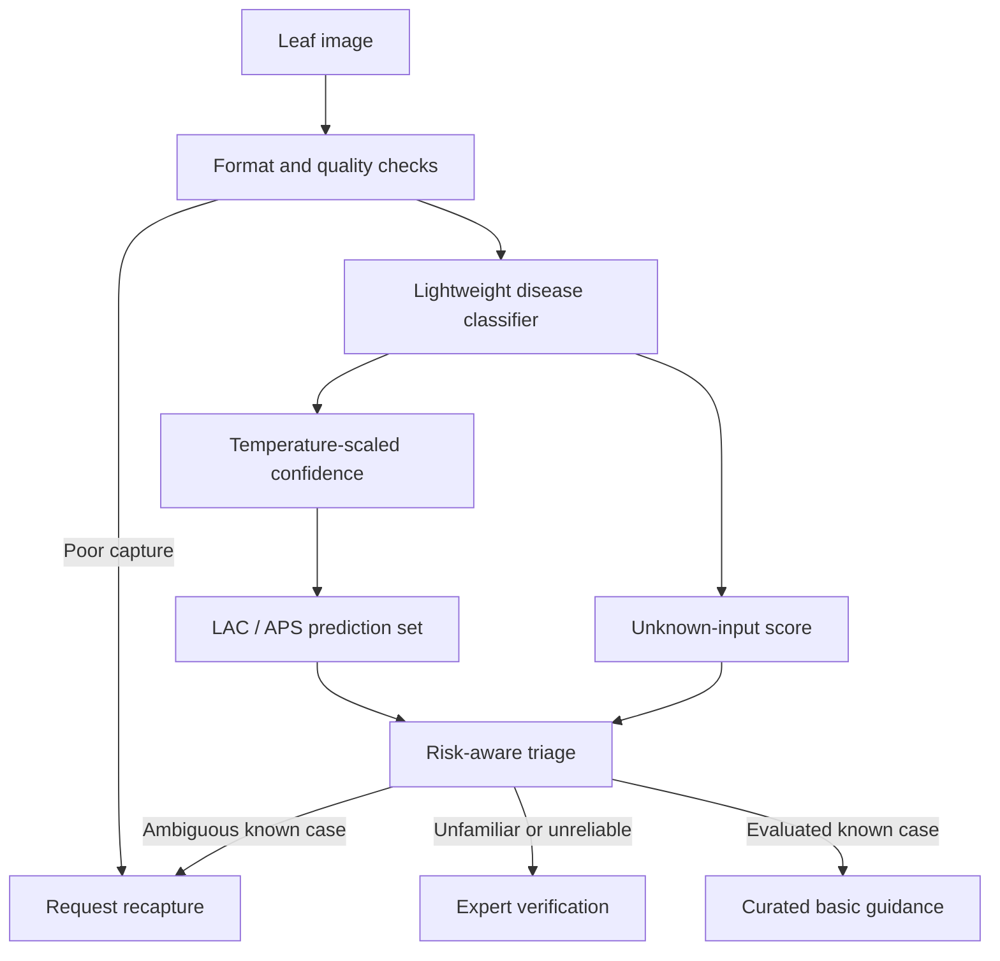

# Project flow and research boundaries

## Research sequence

1. Confirm one crop and a manageable source/field-compatible class list. Audit source identity, licensing, class counts and label noise.
2. Save grouped manifests for training, model selection, temperature fitting, conformal calibration, policy development and untouched tests. Keep related leaves and augmentation derivatives together. Perceptual deduplication alone cannot prove independence.
3. Train a lightweight pretrained baseline using public data. Preserve run seeds/configuration; export ONNX and verify framework-to-ONNX parity.
4. Fit scalar temperature on its own partition. Fit LAC and APS quantiles separately. Compare source-only calibration and separately declared target-domain calibration.
5. Fit an unfamiliar-input threshold using policy-development data. Hold out actual unseen disease classes for testing; distinguish same-crop diseases from non-leaf objects and poor capture.
6. Compare forced prediction, confidence rejection, calibrated rejection and combined triage at matched acceptance coverage. Report classification, calibration, set coverage/size, unknown detection and risk–coverage with sample counts/uncertainty intervals.
7. Curate attributable low-risk management information for selected classes. Enable guidance only after independent policy evaluation. Disease labels alone cannot establish action correctness.

## Current mathematical conventions

LAC uses 1 minus class probability. APS directly inverts deterministic inclusive-prefix cumulative probabilities; ties share the cumulative block score, and empty sets are possible. Finite-sample quantile rank is ceil((n+1)(1-alpha)); an out-of-range rank means the full label set. Core coverage is marginal under exchangeability and independence from model fitting/selection; there is no automatic field-shift or accepted-subset guarantee. Large/singleton/empty sets do not replace an evaluated unknown-input detector.

Quality checks are exposure/contrast heuristics, not a trained leaf detector. The local adapter exposes energy thresholding but contains no invented fitted cutoff. Standard source calibration does not establish deployment reliability. Monitoring advice must not imply that delaying expert verification is safe.

## Primary methodological references

- Temperature scaling: https://proceedings.mlr.press/v70/guo17a.html
- APS: https://arxiv.org/abs/2006.02544
- Conformal assumptions: https://arxiv.org/abs/2107.07511
- Energy scoring: https://arxiv.org/abs/2010.03759

The supplied project proposal remains authoritative for scope. Research notes are secondary leads, not independently verified proof. The UI's illustrative examples are not training data or experimental results.

## Current flow status (5 November 2026)

The in-app flow now separates eight stages: photograph → capture gate → classifier → calibrated confidence → conformal label set → unfamiliar-input check → triage → evaluation/iteration. Each stage shows its actual implementation state. Capture gates are heuristic; probability/set calibration is source-only; unfamiliar-input rejection is not validated; guidance is not enabled. Recapture and expert verification are active. The roadmap distinguishes the trained tomato pilot from paddy feasibility and corn fallback candidates.

Next source-v2 experiment is declared in configs/source-v2.json. The source audit found391 additional valid recorded groups from cached/capped listings. The training manifest combines them with250 original training-only groups:641 images,475 for training; all original non-training groups and public-check groups are excluded. Additional source-v2 roles are38 validation,32 temperature,25 conformal,22 policy and49 test. Small healthy conformal counts limit per-class calibration evidence. No claim of field reliability follows from this expansion.

## Current field-data stage

Verified source licence/version →4604 candidate files inventoried →834 first-batch files audited → duplicate/capture/background review (current) → grouped role assignment → field-inclusive training → separate calibration → policy tuning → sealed final evaluation. Inventory includes905 labelled healthy; first batch includes255. No final-test assignment or model change yet. Guidance disabled; paddy and corn future work.

Duplicate-review checkpoint:834 audited →805 pending capture/background review;21 duplicate copies,4 label conflicts,3 prior-scene overlaps and1 damaged file withheld. Roles remain unassigned. Field-collected plain-background photos must be distinguished from natural-field scenes before evaluating domain shift.
